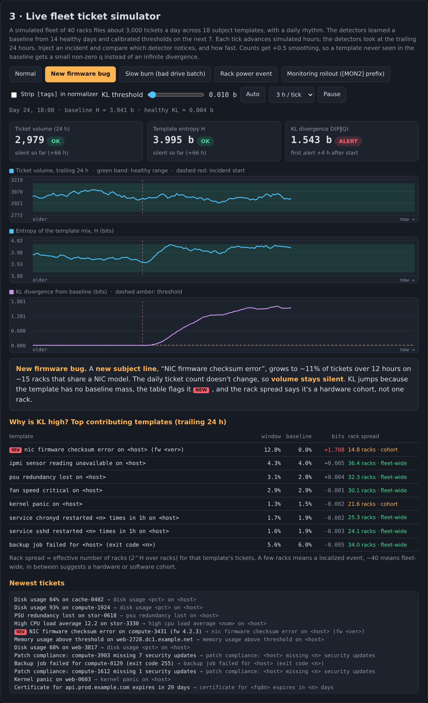
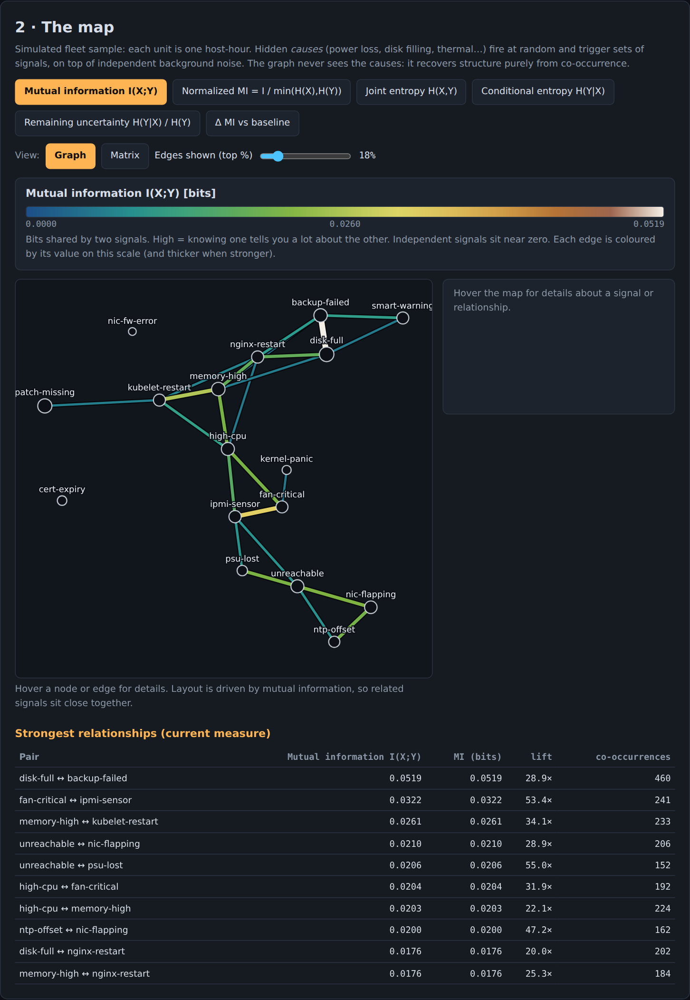
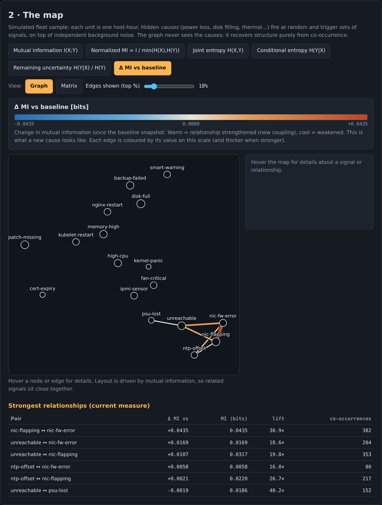
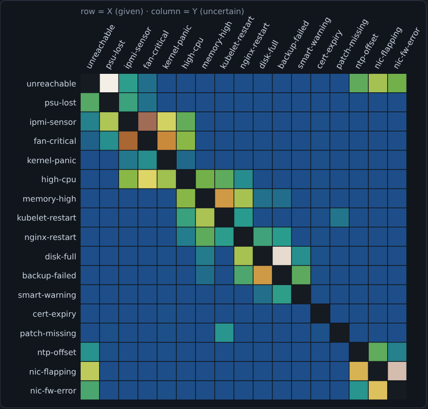

# Driftwatch

Dependency-free HTML pages showing how **Shannon entropy**, **KL divergence**, **joint / conditional entropy** and **mutual information** can find problems in infrastructure telemetry. The focus is a large server fleet's **ticket subject lines**: catch the moment the signal starts to change, and see which signals move together.

**Live demo:** https://otisranson.github.io/Driftwatch/ · or just open the files in a browser (no build, no network).

## Page 1 — `index.html`: ticket subject drift

Subjects are normalized into templates (hostnames, numbers, IPs and versions stripped), counted over a trailing 24 h window, and compared with a baseline learned from healthy history. Three detectors run side by side — **ticket volume**, **entropy** and **KL divergence** — each reporting how many hours after an incident it first alerted.

*Above: a new firmware bug starts producing a brand-new subject line (dashed red line = incident start). Volume stays inside its healthy band, entropy leaves its band after about 6 h, and KL crosses its threshold after about 2 h. The table names the culprit template, tags it `NEW`, and reports its rack spread ("cohort").*

Contents:

1. **The two ideas**: H(P) and D(P‖Q).
2. **Pipeline + normalizer**: interactive; 400 sample tickets collapse from ~398 unique subjects to 18 templates.
3. **Live fleet simulator**: 40 racks, ~3,000 tickets/day. Scenarios: new firmware bug, slow burn (bad drive batch), rack power event, and a monitoring rollout that rewrites subject formatting (a false positive that normalization fixes).
4. **Bring your own tickets**: paste subject lines, processed locally in the browser.
5–7. Playground (P vs Q), live traffic detector, load-balancer evenness.
8. Where this fits, with practical notes.

## Page 2 — `cooccurrence.html`: signal co-occurrence map

Treat each normalized ticket subject as a **signal**, count which signals fire together on the same host in the same hour, and colour every edge of the graph with an information-theoretic measure on a topographic (hypsometric) scale — blue low ground, through green and yellow, to white peaks — with a legend.

| Measure | What it shows |
|---|---|
| **Joint entropy** H(X,Y) | Total uncertainty of the pair; glows for busy signals whether or not they are related |
| **Conditional entropy** H(Y\|X), and H(Y\|X)/H(Y) | Uncertainty left in Y once X is known. Directional: the matrix view shows every ordered pair |
| **Mutual information** I(X;Y), and normalized MI | Shared information; the cleanest "these belong together" score |
| **Δ MI vs baseline** | What a new underlying cause looks like: new edges light up |

*Mutual information map: edges are coloured by value (see the legend) and thicker when stronger. Tightly related signals (disk-full · backup-failed, fan-critical · ipmi-sensor, memory-high · kubelet-restart…) sit together and light up.*

*Δ MI after injecting a new hidden cause (NIC firmware bug): new warm edges appear around `nic-fw-error`, `nic-flapping`, `unreachable` and `ntp-offset`, while the rest of the map stays neutral.*

*Matrix view of remaining uncertainty H(Y|X)/H(Y): rows = X (given), columns = Y. The matrix is not symmetric, which is the point of conditional entropy.*

Controls: switch measure, graph/matrix view, how many edges to show, toggle the hidden causes that generate the data, change the sample size (watch spurious edges appear at small N), resample, and set the baseline snapshot.

## Notes

- All data is simulated; nothing leaves your browser.
- Normalization rules are regexes written for the simulated subjects; tune them for your own ticket system.

## License

MIT
