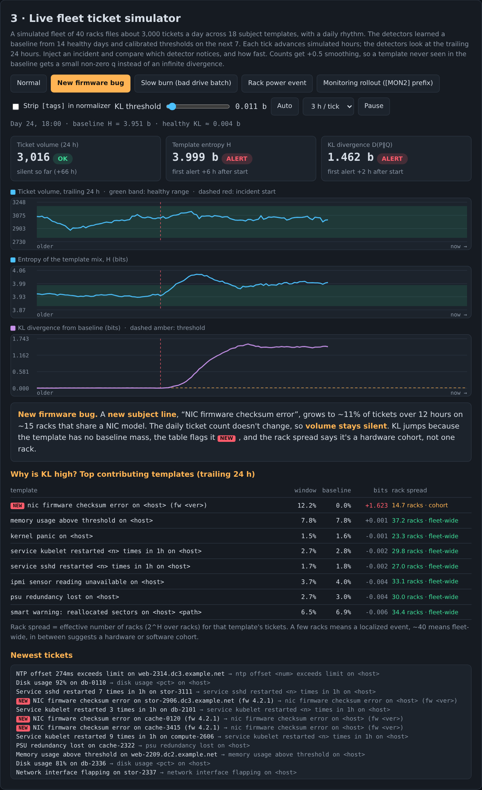
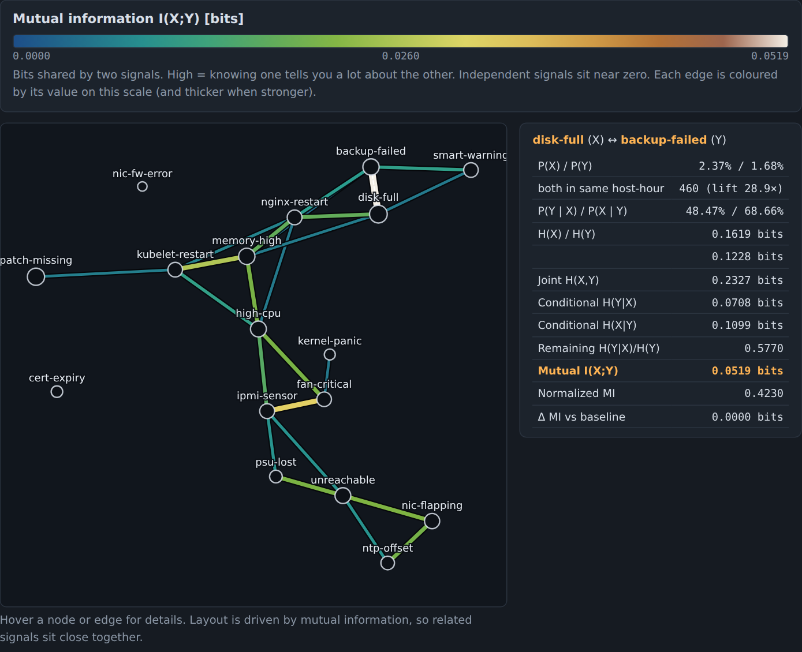
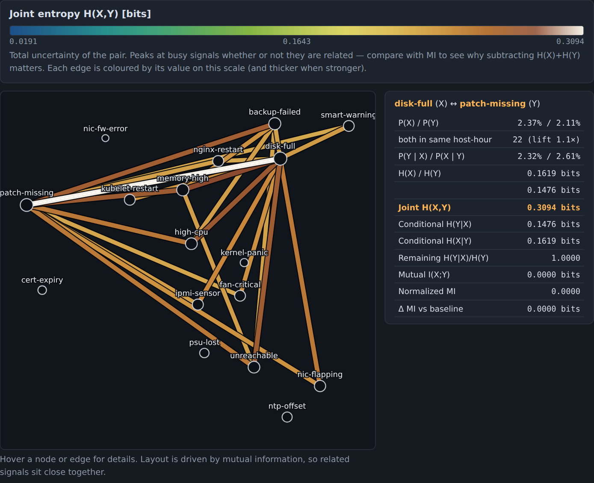
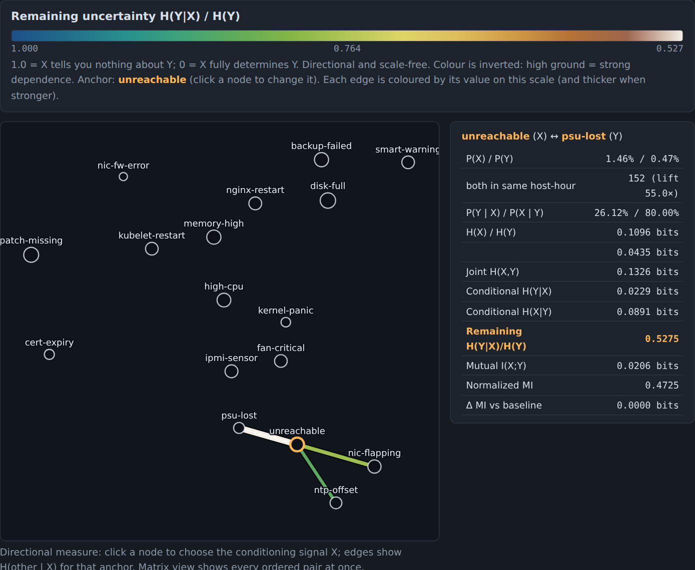
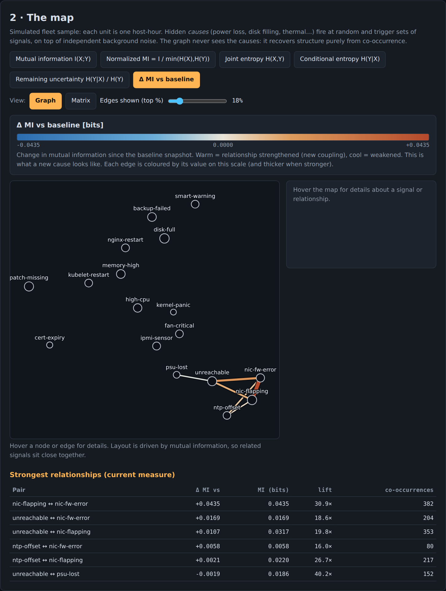
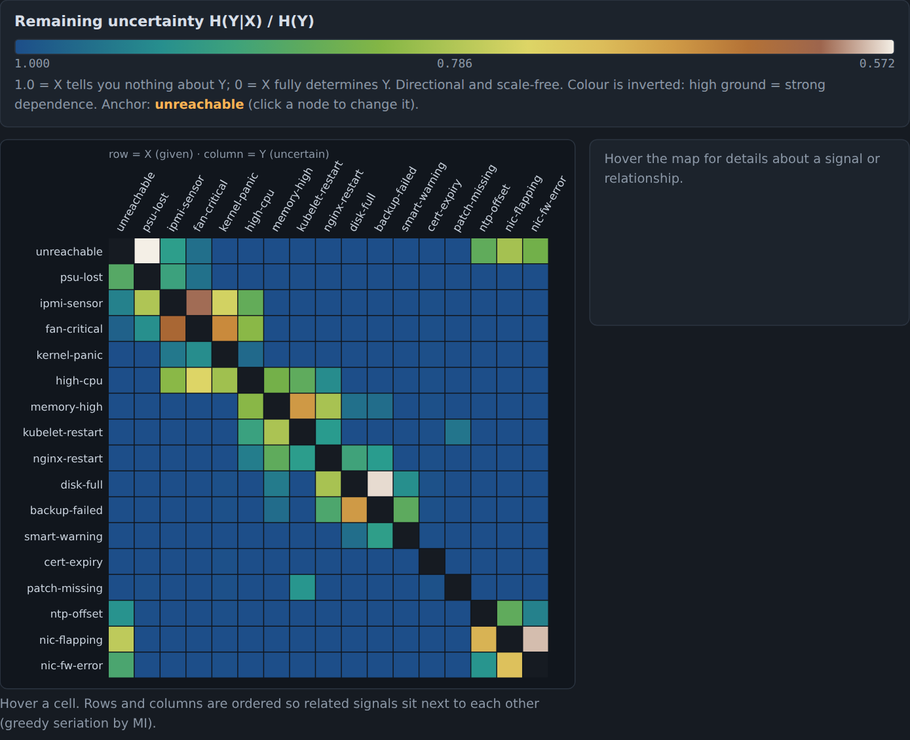
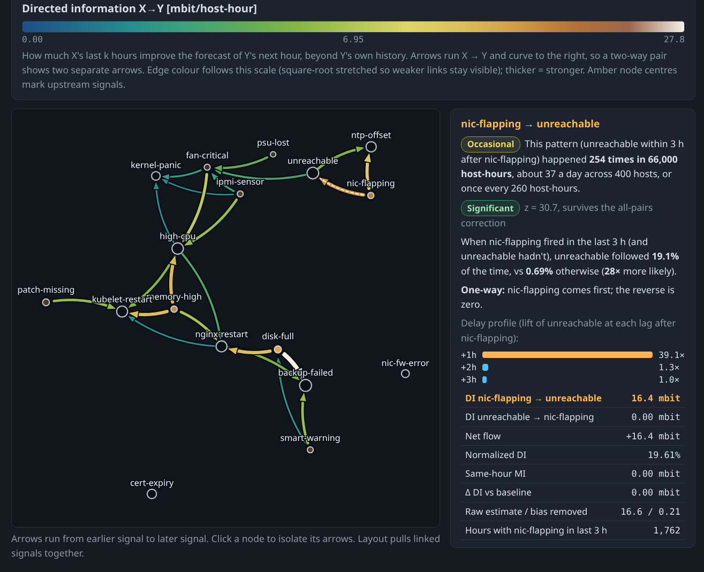
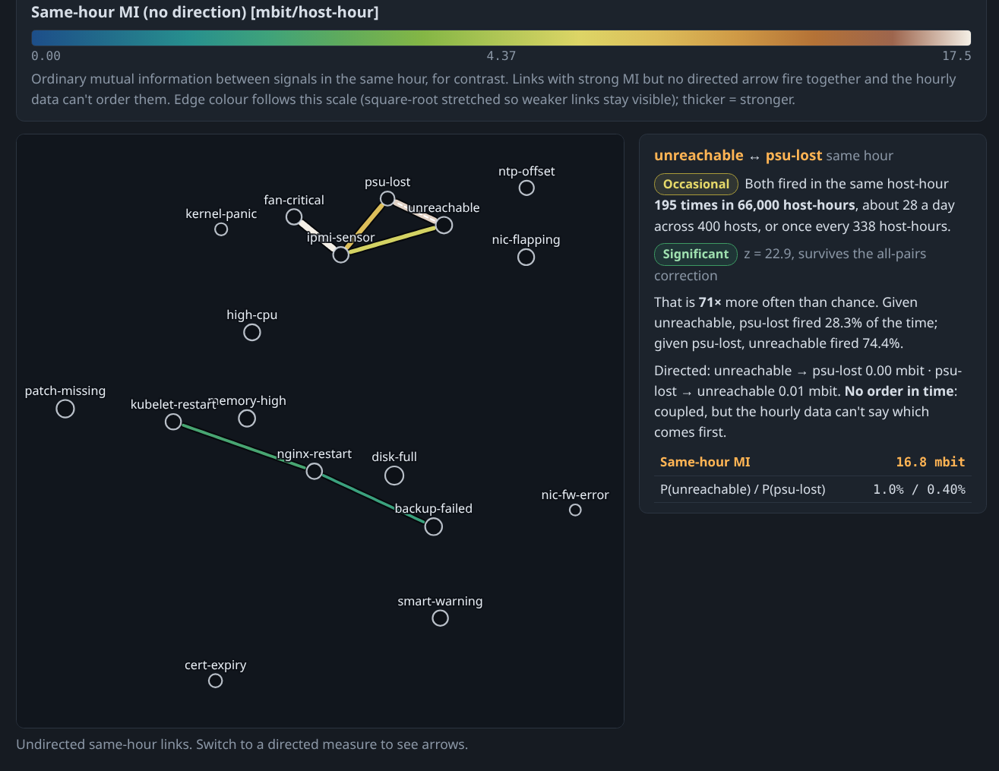
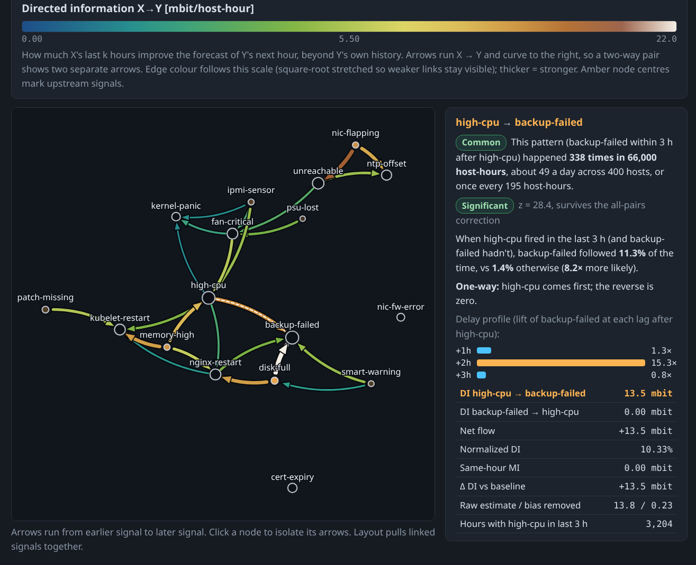
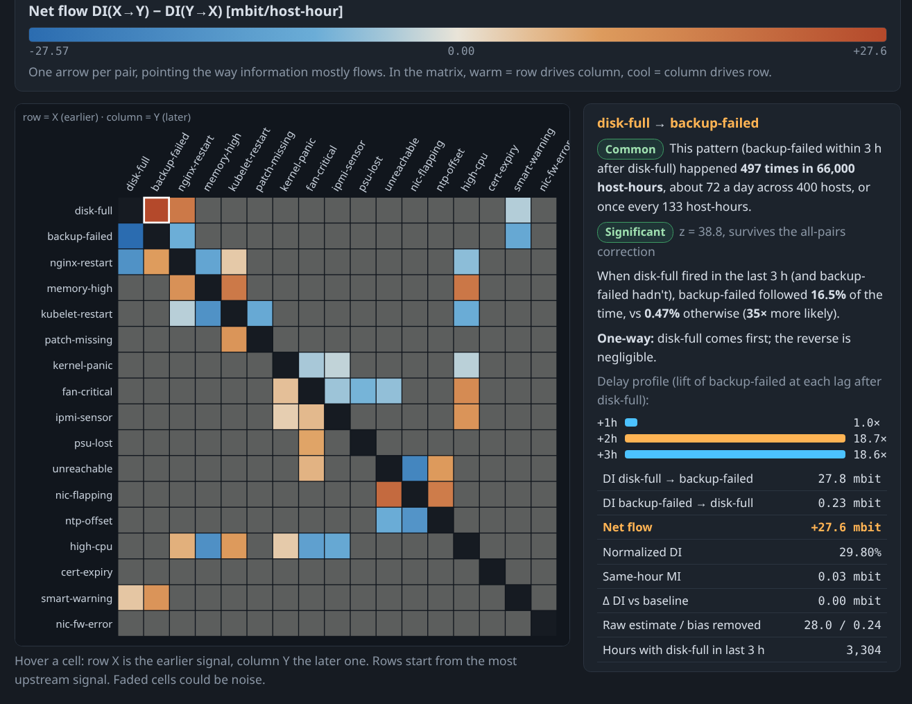

# Driftwatch

Dependency-free HTML pages showing how **Shannon entropy**, **KL divergence**, **joint / conditional entropy**, **mutual information** and **directed information** can find problems in infrastructure telemetry. The focus is a large server fleet's **ticket subject lines**: catch the moment the signal starts to change, and see which signals move together.

**Live demo:** [ticket drift detector](https://otisranson.github.io/Driftwatch/) · [signal co-occurrence map](https://otisranson.github.io/Driftwatch/cooccurrence.html) · [directed information map](https://otisranson.github.io/Driftwatch/directed.html) · or just open the files in a browser (no build, no network).

## Page 1 — `index.html`: ticket subject drift

Subjects are normalized into templates (hostnames, numbers, IPs and versions stripped), counted over a trailing 24 h window, and compared with a baseline learned from healthy history. Three detectors run side by side — **ticket volume**, **entropy** and **KL divergence** — each reporting how many hours after an incident it first alerted.

*Above: a new firmware bug starts producing a brand-new subject line (dashed red line = incident start). Volume stays inside its healthy band, entropy leaves its band after about 6 h, and KL crosses its threshold after about 2 h. The table names the culprit template, tags it `NEW`, and reports its rack spread ("cohort").*

Contents:

1. **The two ideas**: H(P) and D(P‖Q).
2. **Pipeline + normalizer**: interactive; 400 sample tickets collapse from ~398 unique subjects to 18 templates.
3. **Live fleet simulator**: 40 racks, ~3,000 tickets/day. Scenarios: new firmware bug, slow burn (bad drive batch), rack power event, and a monitoring rollout that rewrites subject formatting (a false positive that normalization fixes).
4. **Bring your own tickets**: paste subject lines, processed locally in the browser.
5–7. Playground (P vs Q), live traffic detector, load-balancer evenness.
8. Where this fits, with practical notes.

## Page 2 — `cooccurrence.html`: signal co-occurrence map

**Open it:** [live page](https://otisranson.github.io/Driftwatch/cooccurrence.html) · [source file](cooccurrence.html)

Treat each normalized ticket subject as a **signal**, count which signals fire together on the same host in the same hour, and colour every edge of the graph with an information-theoretic measure on a topographic (hypsometric) scale — blue low ground, through green and yellow, to white peaks — with a legend above the map. Edges are also thicker when stronger. Hover any node or edge for the full breakdown (probabilities, lift, H(X), H(Y), H(X,Y), conditionals, MI).

| Measure | What it shows |
|---|---|
| **Joint entropy** H(X,Y) | Total uncertainty of the pair; glows for busy signals whether or not they are related |
| **Conditional entropy** H(Y\|X), and H(Y\|X)/H(Y) | Uncertainty left in Y once X is known. Directional: pick an anchor node in the graph, or use the matrix for every ordered pair |
| **Mutual information** I(X;Y), and normalized MI | Shared information; the cleanest "these belong together" score |
| **Δ MI vs baseline** | What a new underlying cause looks like: new edges light up |

### Mutual information

Related signals (disk-full · backup-failed, fan-critical · ipmi-sensor, memory-high · kubelet-restart, unreachable · nic-flapping…) sit together, and their edges run from green to white as the relationship strengthens.

### Joint entropy, for contrast

The same data under joint entropy: the busiest signals dominate, related or not. Subtracting H(X)+H(Y) to get mutual information is what removes this.

### Conditional entropy, anchored on one signal

Remaining uncertainty H(Y|X)/H(Y) given `unreachable` (the amber-ringed anchor): 1.0 means it tells you nothing about the other signal, lower means it pins it down. Click any node to change the anchor.

### Change since baseline

After injecting a new hidden cause (NIC firmware bug), new warm edges appear around `nic-fw-error`, `nic-flapping`, `unreachable` and `ntp-offset`, while the rest of the map stays neutral.

### Matrix view

Rows = X (given), columns = Y. The matrix is not symmetric, which is the point of conditional entropy. Rows and columns are ordered so related signals sit next to each other.

Controls: switch measure, graph/matrix view, how many edges to show, toggle the hidden causes that generate the data, change the sample size (watch spurious edges appear at small N), resample, and set the baseline snapshot.

## Page 3 — `directed.html`: directed information (which signal comes first)

**Open it:** [live page](https://otisranson.github.io/Driftwatch/directed.html) · [source file](directed.html)

Mutual information is symmetric, so it can't say whether `nic-flapping` leads to `unreachable` or the reverse. This page simulates **hourly time series per host**: hidden causes set off chains of signals with delays. It then estimates **directed information** with k hours of memory:

DI(X→Y) ≈ I(X₍ₜ₋ₖ..ₜ₋₁₎ ; Yₜ | Y₍ₜ₋ₖ..ₜ₋₁₎)

This is how much X's recent past predicts Y's next hour beyond Y's own past. It is the finite-memory directed-information rate, the same quantity as transfer entropy. Each estimate is bias-corrected and G-tested with a correction for testing every ordered pair.

- **Graph of arrows** (earlier → later), matrix view, net flow DI(X→Y) − DI(Y→X), normalized DI, Δ DI vs baseline, and same-hour MI for contrast.
- **Hover an arrow** for plain language: how many times the pattern happened, a rarity tag (very rare / rare / occasional / common / frequent), the rate per day across the fleet, a significance tag, how much more likely Y is after X, a delay profile by lag, and which direction dominates.
- **Most upstream signals** table: where chains start, i.e. what to work first.
- Experiments: toggle causes, inject a new NIC-firmware chain (Δ DI), add a **hidden confounder** to show that directed ≠ causal, change memory k and fleet size, and **reverse time** as a sanity check (chains flip; same-hour links don't).

### Arrows, with plain-language hover

Chains come out one-way: `disk-full → nginx-restart / backup-failed`, `memory-high → high-cpu → kubelet-restart`, `nic-flapping → unreachable → ntp-offset`. The panel says how often the pattern happened and how rare that is, whether it's distinguishable from noise, and at which delay it peaks.

### Same-hour MI, for contrast

Rack power loss hits `psu-lost`, `unreachable` and `ipmi-sensor` in the same hour. MI links them strongly, but directed information has no arrow between them, because hourly data can't say which came first.

### Hidden confounder: directed ≠ causal

A nightly batch job (not itself a signal) causes high CPU and, two hours later, failed backups. The map draws `high-cpu → backup-failed` even though neither causes the other.

### Net-flow matrix

Rows = earlier signal, columns = later signal. Warm = the row drives the column. Rows are ordered from the most upstream signal down.

## Notes

- All data is simulated; nothing leaves your browser.
- Normalization rules are regexes written for the simulated subjects; tune them for your own ticket system.

## License

MIT
